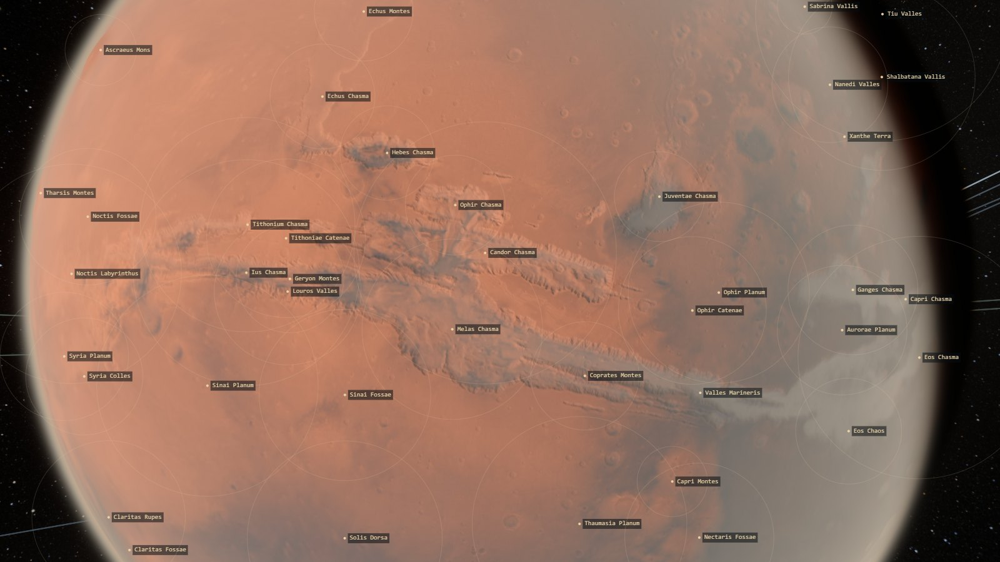
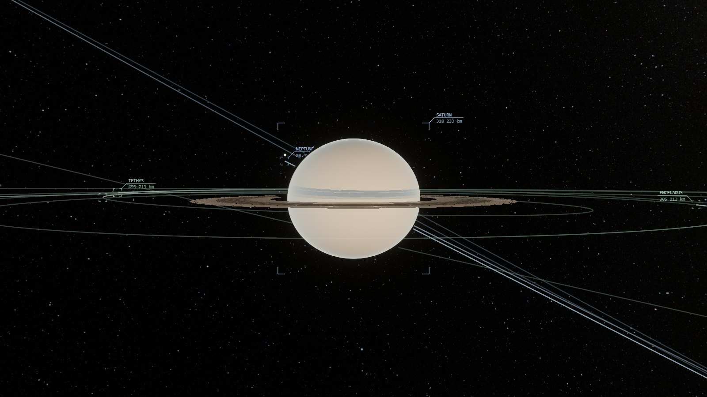
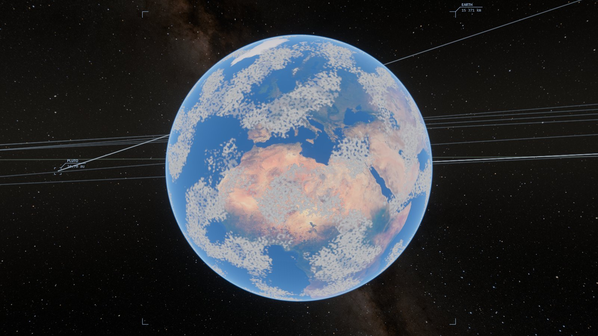
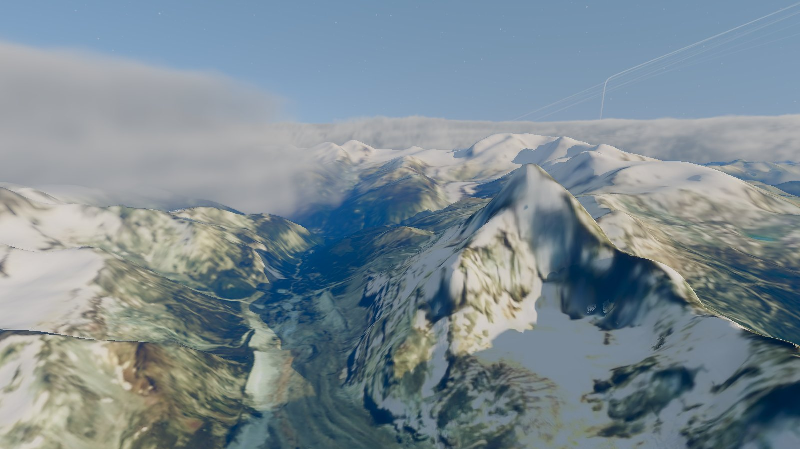
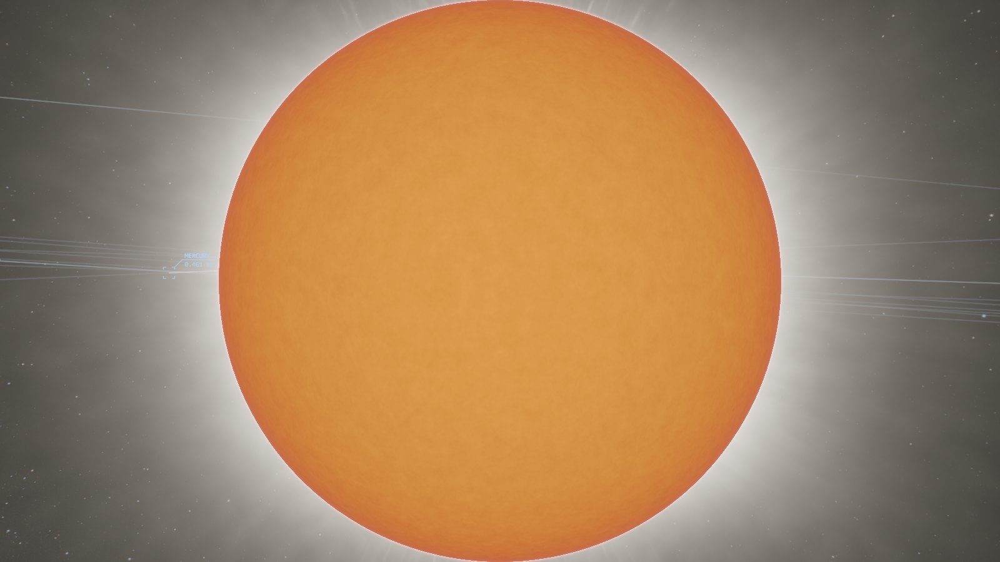
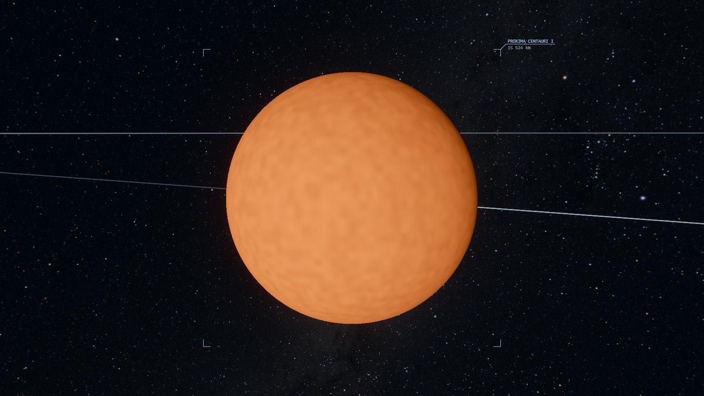
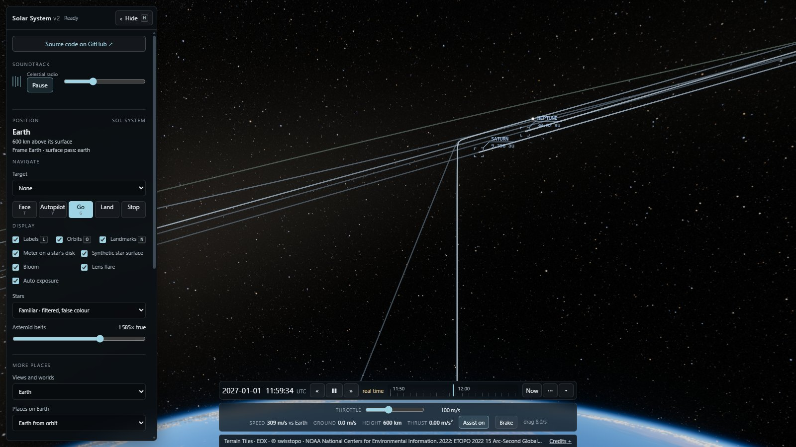

# Solar-System v2

**Fly the solar system in your browser.** Start above your own city on a real-scale Earth,
climb to orbit, cross to the Moon, Mars or Saturn's rings without a loading screen, and
jump on to worlds around other stars. Every crater, mountain and valley the IAU has named
is there to find and read about.

### [▶ Open the app](https://solar-system-seven-snowy.vercel.app)

It needs a browser with WebGPU. The tested case is a recent Edge (Chrome is the same
engine) on a desktop with a real graphics card; see [Browsers](#browsers). The first visit compiles its GPU
programs and takes a while; later visits start faster.



Free and open source: Rust compiled to WebAssembly, drawing with WebGPU, built only on
open data. This is version 2 of [Solar-System](#version-1); it replaces the WebGL2 app.

## What you can do

- **Fly anywhere, without a cut.** One camera goes from a few metres over the ground to
  orbit, across the system and out of it. Positions are kept in 64-bit sectors, so
  centimetres and light years live in the same flight. Thrust and coast yourself, or pick a
  target and let **Face**, **Autopilot**, **Go** (a five-second trip) or **Land** take you.
- **Visit a real Earth.** Heights, satellite imagery, buildings, roads, rivers and lakes
  stream from free open sources as you fly, under volumetric clouds, with an ocean that has
  waves and shores, sun shadows cast by the real relief, and procedural trees, rocks and
  grass on the ground.
- **Land on the Moon, Mars and sixteen more worlds.** Mercury, Venus, the Moon, Mars and
  Phobos, the large moons of Jupiter and Saturn, Triton, Pluto and Charon are drawn from
  the global maps of the missions that went there, with real relief where an elevation
  model exists (the Moon, Mercury, Venus, Mars, Pluto and Charon).
- **Read the map.** Press **N** and the IAU's official names appear on the nearest world:
  15,544 features on 25 bodies. Click one to read what it is, how large, and who or what it
  was named after, then go there.
- **Move through time.** The planets and moons follow a JPL ephemeris. Run the clock
  forward or backward, from real time to a year per second, or set a date and watch the
  shadows, the phases and the moons of Jupiter where they were or will be.
- **Leave for another star.** A hyperdrive jump takes you to Proxima Centauri, TRAPPIST-1,
  Tau Ceti, Epsilon Eridani or Kepler-186. Each star is drawn in the colour of its
  catalogued temperature and lights its worlds in that colour. The 23 worlds themselves are
  procedural: nobody has seen their surfaces, and the app says so.
- **Go and look at the Sun.** A model, not a photograph: limb darkening as measured,
  granulation, sunspots, loops, prominences, flares and a corona, in a familiar filtered
  view or in true colour.
- **Listen.** A soundtrack is composed while it plays, in pure intervals tuned to where you
  are; every world has its own note ([docs/MUSIC.md](docs/MUSIC.md)).

The app tells you what is real and what is not. Saturn's colour bands are a placeholder and
it says so; where a moon has no global map, it says that too.

| | |
| --- | --- |
|  |  |
| Saturn, its rings and the orbits of its moons | Earth from 9,000 km. NOAA ETOPO 2022, NASA Blue Marble |
|  |  |
| The Alps near the Matterhorn, streamed live. Imagery: EOX Sentinel-2 cloudless, ©swisstopo | The Sun: a model, with its corona |
|  |  |
| A synthetic world in the red light of Proxima Centauri | The panel, the time line and the flight readout |

## Controls

Everything is in one panel (top left) and one dock (bottom centre). The panel lists the keys
under **Keys and gestures**; the essentials:

| Key | Action |
| --- | --- |
| W / S | Thrust forward / back (the wheel sets the throttle) |
| A / D, Space / C | Strafe sideways, up / down |
| Q / E | Roll |
| Right-drag | Look |
| Shift | Boost |
| X | Brake |
| Z | Hover assist on / off |
| T, Y, G | Face the target, autopilot to it, go to it |
| , / . and P | Slow down / speed up the clock (below the pause it runs backward); pause |
| [ / ] | Step back / forward in time |
| L, O, N | Labels, orbits, landmarks on / off |
| Esc | Stop a trip, or cancel a hyperdrive jump before it starts |
| H | Collapse or open the panel |
| F11 | Full screen |

- **Panel:** a link to this repository, the soundtrack (Play / Pause, volume, what is playing), where you are, the
  target with Face / Autopilot / Go / Land / Stop, the display switches, **Views and worlds**
  (every body, whole-system views, the five star systems) and **Places on Earth**, then the
  quality preset and the detailed settings, the key list and the support links.
- **Time line** (dock): date, time and zone, slower / pause / faster, the clock rate in
  words, a strip you can drag to move in time, **Now**, and **⋯** for steps, a chosen date,
  UTC or local time and the Julian Date.
- **Flight readout** (dock): throttle, speed against the nearest body, height, thrust,
  assist and brake.
- **Touch:** a stick and a throttle bar, drag to look, twist to roll, tap a label to target
  it.

Useful addresses:

| URL | Opens |
| --- | --- |
| `/` | The solar system, starting 600 km above the main city of your time zone (read from the browser's time zone setting: no location permission, no request) |
| `/?view=matterhorn` | A named place on Earth (`lavaux`, `matterhorn`, `earth-orbit` and others: `PLACES` in `crates/solar-explorer/src/world.rs`) |
| `/?quality=medium` | A quality preset: `ultra`, `high`, `medium`, `low`, `minimal` |
| `/explorer.html?body=earth` | Earth alone, with every rendering setting in the panel |
| `/explorer.html?body=procedural` | A procedural Earth-sized planet that needs no data at all |

## Built on open data

Nothing here would exist without the people and agencies who publish their data freely.
The app shows the credits of whatever is in view; the complete list with terms is in
[THIRD-PARTY-NOTICES.md](THIRD-PARTY-NOTICES.md).

| What you see | Comes from |
| --- | --- |
| Earth imagery | [EOX Sentinel-2 cloudless](https://cloudless.eox.at) by EOX IT Services GmbH (contains modified Copernicus Sentinel data); [swisstopo](https://www.swisstopo.admin.ch) SWISSIMAGE in Switzerland |
| Earth heights and seabed | [Terrain Tiles](https://registry.opendata.aws/terrain-tiles/) on AWS Open Data (USGS 3DEP, SRTM, GMTED2010 and national surveys) |
| Buildings, roads, rivers, lakes | [OpenStreetMap](https://www.openstreetmap.org/copyright) contributors, through [OpenFreeMap](https://openfreemap.org/) and OpenMapTiles |
| Earth from far away | NOAA ETOPO 2022; NASA Earth Observatory's Blue Marble Next Generation |
| The Moon, Mercury, Venus, Mars, Phobos, the moons of Jupiter and Saturn, Triton, Pluto, Charon | Global mosaics and elevation models distributed by [USGS Astrogeology](https://astrogeology.usgs.gov/), from LRO, MESSENGER, Magellan, Viking, Mars Global Surveyor, Voyager, Galileo, Cassini, Mars Express and New Horizons |
| Jupiter | Cassini's map of 2000, NASA/JPL/Space Science Institute |
| The names of surface features | The IAU Working Group for Planetary System Nomenclature's [Gazetteer of Planetary Nomenclature](https://planetarynames.wr.usgs.gov/), kept by USGS Astrogeology |
| Where everything is, and when | JPL planetary and satellite ephemerides, distributed by NAIF |
| The sky | NASA/Goddard Space Flight Center Scientific Visualization Studio, Deep Star Maps 2020 (Gaia DR2: ESA/Gaia/DPAC); the Yale Bright Star Catalogue |
| Asteroids | The JPL Small-Body Database |
| The stars you can visit | Published measurements, read through the NASA Exoplanet Archive and SIMBAD |

No Google or Esri data is used. One source, the EOX imagery, is licensed for
**non-commercial** use: a commercial build must replace it.

## Build it from source

You need:

- Rust through [rustup](https://rustup.rs/). `rust-toolchain.toml` pins 1.87.0 with the
  `wasm32-unknown-unknown` target, rustfmt and clippy; rustup installs them on first use.
- The `wasm-bindgen` command at the version in `Cargo.lock`:
  `cargo install wasm-bindgen-cli --version 0.2.128 --locked`
- Node 22 or later. It runs the local server and the tools; there are no npm packages.
- PowerShell for the `.ps1` scripts: Windows PowerShell 5.1, or `pwsh` elsewhere.
- A browser with WebGPU.

```powershell
git clone https://github.com/3merillon/Solar-System
cd Solar-System
./tools/Run.ps1              # build the WASM into web/pkg/ and serve web/ on http://127.0.0.1:5198/
./tools/Run.ps1 -NoBuild     # serve the last build
./tools/Build-Explorer.ps1   # build only
node tools/serve.mjs --port 5199   # serve web/ on another port
```

The first build compiles everything and takes a few minutes (244 s from a clean clone on the
workstation described under [Measured](#measured)); the result is an 11.9 MB WebAssembly
file, 3.2 MB as served with Brotli. The `.ps1` scripts have only been run on Windows. On
Linux the tested path is the deployment script below.

### Data packs

Earth near the ground streams from the live sources above and needs nothing else.
Everything seen from far away (the star background, the other bodies' maps and relief,
Earth from orbit) comes from baked **data packs**, about 2.5 GB in 169 files, which are
not in this repository. A build without them still runs: the procedural planet is complete
and live Earth works near the ground, but Earth from orbit is a plain blue sphere with
clouds, and the solar system has no star background and no surface maps.

Two ways to get them for a local build:

- **Download them.** One command fetches the same packs the public site uses from this
  repository's [`packs-v1` release](https://github.com/3merillon/Solar-System/releases/tag/packs-v1)
  into `web/pack/` and checks every file against the hashes in `tools/packs.json`:

  ```powershell
  node tools/Fetch-Packs.mjs            # about 2.5 GB; run it again to resume
  node tools/Fetch-Packs.mjs --check    # verify what is there
  ```

  After that the local server shows everything the public site does.
- **Bake your own.** `crates/solar-bake` builds every pack from the public sources
  (`cargo run --release -p solar-bake -- ...`; its commands and options are listed at the top
  of `crates/solar-bake/src/main.rs`). [THIRD-PARTY-NOTICES.md](THIRD-PARTY-NOTICES.md) names
  the products each pack was made from, and every pack's `manifest.json` records its own.
  The options used for each body of the published bake (the height scale and offset of each
  elevation product) are not recorded in this repository: read them from the product's
  label. Put the output in `web/pack/`.

A deployed site reads its packs from a host of your own, named when the site is built
(next section). A pack host must answer over HTTPS with `Access-Control-Allow-Origin` and must honour byte
ranges (`206 Partial Content`): the fine levels are one bundle file per cube face and level,
and the app reads single pages out of them by range. A host that ignores ranges is refused,
never read whole. `node tools/serve.mjs --cors` stands in for such a host locally.

### Deploy

`bash tools/Build-Vercel.sh` builds the static site into `dist/` on Linux x86-64 (it
installs the toolchain if missing, downloads the matching wasm-bindgen release and checks
its hash). `vercel.json` runs it, so importing the repository into Vercel is enough; any
static host that serves `dist/` works. Set `SOLAR_PACK_BASE` in the build's environment to the
address of your pack host (an `https://` URL ending in `/`, under which the folders of
`web/pack/` are served); without it the site is built without packs. The release downloads
cannot serve a deployed site: they send no `Access-Control-Allow-Origin`.

## How it works

- **One radial surface, generated on the GPU.** Terrain is an adaptive mesh over a cube
  sphere, scheduled and generated in compute shaders. The decision and what it was chosen
  over: [docs/DECISION.md](docs/DECISION.md),
  [docs/SINGLE-SKIN.md](docs/SINGLE-SKIN.md).
- **Reference maths apart from the renderer.** `crates/solar-core` holds the surfaces and
  their bounds, the height pages, the ephemeris and the flight model in plain Rust with
  native tests, so the shaders can be checked against something that is not a shader.
- **Live Earth.** A worker turns map tiles into the renderer's height, imagery, water and
  vector pages while you fly: [docs/M1-LIVE-EARTH.md](docs/M1-LIVE-EARTH.md).
- **Water, clouds, shadows, scenery.** [docs/WATER-LAYER.md](docs/WATER-LAYER.md),
  [docs/SUN-SHADOWS.md](docs/SUN-SHADOWS.md), [docs/SCENERY.md](docs/SCENERY.md).
- **The solar system, the stars and the Sun.** [docs/SOLAR-SYSTEM.md](docs/SOLAR-SYSTEM.md).
- **The finished picture.** Linear light, the AgX tone curve, bloom and a lens flare:
  [docs/HDR-FINISH.md](docs/HDR-FINISH.md).

[docs/README.md](docs/README.md) indexes every document and says which describe the code as
it is and which are dated research logs. No novelty is claimed for any of it; published
methods are cited where they are used.

| Path | Contents |
| --- | --- |
| `crates/solar-core` | Renderer-independent reference maths, tested natively (`cargo test -p solar-core`) |
| `crates/solar-explorer` | The browser renderer (WASM), with a native wgpu backend for validation. `build.rs` specializes and compacts every WGSL program |
| `crates/solar-probe` | Native GPU probes and audits of the shader maths (`tools/Check.ps1 -Gpu`) |
| `crates/solar-bake` | Native pack baking |
| `shaders/` | WGSL sources |
| `web/` | The pages, the render worker, the Earth field worker (`web/field/`), the landmarks (`web/landmarks/`), the score (`web/music-*.js`) |
| `tools/` | Builds, checks, the measurement workflow and regression tests. Each test launches its own private headless browser; none drives your desktop browser |
| `docs/` | Design notes and measured results |

Two developer pages sit beside the app on the development server and are not deployed:
`web/compile-bench.html` (times shader compilation) and `web/music-lab.html` (plays the
score's pieces on their own).

## Measured

One workstation, one day: a record, not a promise. Intel i7-12700F, NVIDIA RTX 3080,
Windows 11, a private headless Edge 157 (Chromium), 1920 x 1080, High preset, GPU otherwise
idle, 17 November 2026. One 14-second flight per scene (`tools/Trace-Flight.mjs`), summarised
after the first 8 seconds.

| Scene | GPU time per frame, p50 / p95 / p99 |
| --- | --- |
| Earth, hovering over the vineyards of Lavaux (live data, water, clouds, scenery) | 42.0 / 44.3 / 45.3 ms |
| Mars, descending from 200 km | 9.8 / 11.6 / 11.9 ms |
| A procedural world of Proxima Centauri, descending from 200 km | 11.8 / 14.8 / 14.9 ms |
| The Sun from two solar radii | 2.6 / 2.8 / 2.9 ms |

- **Earth near the ground is not at 60 frames per second** on this machine: about 24. The
  other bodies, the procedural worlds and space are. Where Earth's time goes, stage by
  stage, as measured on 14-15 November: [docs/FRAME-COST-PASS-2.md](docs/FRAME-COST-PASS-2.md).
- **Starting takes a while.** The app compiles 87 GPU programs. With a new browser profile,
  the first picture came after 13 s and everything was ready after 35 s
  (`tools/Profile-Startup.mjs`); a second start of the same profile took 11 s and 27 s. The
  graphics driver keeps its own cache across browser profiles and this machine had run the
  app before, so a computer that never has will take longer: with that cache forced empty,
  compiling every program took 76 s on 15 November ([docs/STARTUP.md](docs/STARTUP.md)), and
  the Sun's model has grown since. The app itself is an 8 MB download; the data streams as
  you fly.
- **Not measured:** phones, tablets, laptops with integrated graphics, and every frame time
  outside this one machine. The lower presets (`medium`, `low`, `minimal`) exist for them
  and are not qualified.

### Browsers

| Browser | What was seen |
| --- | --- |
| Edge 157 (Chromium) on Windows 11, RTX 3080 | Everything on this page, and every automated check, on 17 November 2026 |
| Safari 27 on an iPad (M1 class) | Starts and flies, on 16-17 November 2026. Frame time not measured |
| Chrome | Expected to behave as Edge (the same engine); not run separately |
| Firefox, Android browsers, macOS desktops | Not tested |

The interface can be reached with the Tab key, and every control has a name and a visible
focus ring, but its buttons cannot be pressed from the keyboard alone: Space and Enter fly
the craft. It is a mouse or touch interface.

## Checks

```powershell
./tools/Check.ps1        # fmt, tests, clippy (native and WASM), WASM build checks, shader validation
./tools/Check.ps1 -Gpu   # plus the native GPU probe and its audits (after shader changes)
```

Measurement and image regression run one GPU job at a time, against an immutable copy of
the site:

```powershell
node tools/Snapshot-To.mjs <dir> [--pack [bake dir]]   # immutable copy of web/ to measure
node tools/serve.mjs --port 5301 --root <dir>          # serve it
node tools/Trace-Flight.mjs --base http://127.0.0.1:5301/ --scenes earth-hover --seconds 14
node tools/Compare-Builds.mjs http://127.0.0.1:5301 http://127.0.0.1:5302   # byte-exact captures
```

How the numbers in `docs/` were measured (interleaved pairs, p50 / p95 / p99, contamination
checks): [docs/FRAME-COST-PASS-2.md](docs/FRAME-COST-PASS-2.md#how-it-was-measured).

## Version 1

Solar-System v1 was a WebGL2 app ("Retro Solar Explorer"). Its source is this repository's
history up to the tag [`v1.0.0`](https://github.com/3merillon/Solar-System/tree/v1.0.0).
Version 2 shares no code with it.

## Support

Solar-System v2 is free. If you enjoy it, a
[one-time donation](https://buy.stripe.com/3cIcN77Lg7xv2g68sQdnW00) supports more
open-source work. More from the author: [3merillon.com](https://3merillon.com),
[@3merillon on X](https://x.com/3merillon), and
[Pinionfall](https://dev.pinionfall.com), a custom voxel engine in Rust with its source
for sale.

## Licence

The code is MIT ([LICENSE](LICENSE)). The data, the Rust crates compiled into the app and
the adapted third-party code keep their own terms:
[THIRD-PARTY-NOTICES.md](THIRD-PARTY-NOTICES.md), and `web/THIRD-PARTY-NOTICES.txt` and
`web/THIRD-PARTY-RUST.txt`, which ship with the app.
