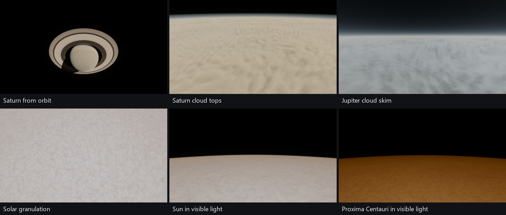

# Spaceflight visual plan

Proposed on 27 November 2026 against revision `1bc9619`.

**Build one continuous Saturn flyby first.** Start high enough to see the planet's shadow on the rings. Skim the sunlit cloud tops, cross the shadow of the B ring, then descend until haze swallows the horizon. The shot should work in free flight at any heading. Saturn tests the lighting from a distance. Jupiter is the second destination because individual high clouds casting shadows on a lower deck are visible in Juno imagery. [Cassini, *On the Final Frontier*](https://science.nasa.gov/resource/on-the-final-frontier/) · [Juno, *Luminous Clouds*](https://www.jpl.nasa.gov/images/pia23604-luminous-clouds/)

## Implemented in the explorer

1. Saturn uses the Hubble OPAL map from 22 October 2023. The baker reconstructs obscured latitudes and produces a hash-pinned asset bundled with the explorer. [Bake and provenance](BAKING.md#saturn-weather)
2. Sunlight traverses an oblate atmosphere and cloud deck. Each lit sample receives ring transmission across the apparent solar disk and cloud extinction along its sunward path. The ring sheet uses the same optical-depth profile.
3. Approaches to Saturn and Jupiter resolve detached cloud heads over a deep deck. The density field rotates with the planet and shears by latitude. Both flights are available under **Views and worlds** and can be interrupted with a flight control.
4. **Spacecraft camera** meters the diffuse sky, catalog stars and planets together. Manual EV locks exposure for comparisons. [HDR finish](HDR-FINISH.md)
5. Stellar close-ups default to the visible continuum. The near limb integrates the photospheric source function through a finite opacity layer. Bright upflows and dark downflow lanes evolve in the star’s rotating frame. Catalog temperature and gravity scale the appearance of other stars. Elevated emission in H-alpha and extreme ultraviolet remains available in the filtered composite. Granules and active regions are models. [NSO resolved photospheric observations](https://nso.edu/press-release/new-images-released-by-nsfs-inouye-solar-telescope/) · [NASA on visible-light coronal contrast](https://science.nasa.gov/blogs/the-sun-spot/2018/09/21/sneak-a-peek-at-the-suns-mysterious-atmosphere-with-a-coronagraph/)

The Saturn route uses the ring opening on 10 October 2013. Orbital weather comes from the separate 2023 observation. The flight is a rendering demonstration. The revised quality target is 33.3 ms per frame at 1080p High, with 16.7 ms desirable. High and Ultra retain native-resolution giant atmospheres, with additional grazing-ray samples on Ultra.

### Flight verification

The 55-second Saturn flight with continuous ring shadows at 1920 × 1080 High on an RTX 3080 recorded 5,158 GPU samples. Whole-frame GPU time was 2.72 ms median, 21.47 ms p95 and 25.98 ms p99. The largest sample was 28.22 ms. The fresh browser took 37.8 seconds to start and warm up before timing. Browser callback intervals were 8.4 ms p95 and 33.3 ms maximum. Callbacks and completed GPU frames are counted separately.

Across four ring-edge sweeps, including a low Sun and an extended volume interval, the largest absolute error in transmitted sunlight was 0.023 on a scale of 0 to 1, compared with 2,048 reference solar rays per position. With the clock stopped, the dark centre of a 31,760 km solar spot registered 112 km apart between opposite views, down from 6,037 km. The test projects both images onto the same plane 500 km below the quiet photosphere. The moving approach and its stationary endpoint produced the same measured centre. The fixed spot views took 7.39–20.92 ms whole-frame GPU p95, including a skim 200 m above the quiet surface. [Shadow and sunspot regression](../tools/Test-Shadow-And-Spots.mjs)

The cloud march sizes each interval from the local density and filters detail smaller than that interval. This keeps foreground samples stable as a neighbouring ray begins to miss the lower deck. Orbit guides fade through the giant’s atmosphere. At stellar approach distances, light and depth accumulate through the emitting gas. The tests check finite HDR channels, the visible limb of the Sun and Proxima, and an oblique solar skim from 120 km down to 460 m.

The deep-space flight points at the Galactic centre from eight astronomical units away. After six simulated seconds of dark adaptation, the median green channel across 16 × 16 pixel tiles rose from 0.08 to 26.46 on a 0–255 scale. Daylight exposure held the median at zero. In the 200 m solar skim, the 99th percentile of horizontal striping fell from 2.75 to 0.31 display levels. The measure averages 32 horizontal pixels and takes the second difference between adjacent rows. The test also checks that cloud and photospheric contrast survive. [Close-flight regression](../tools/Test-Close-Flight.mjs)

| Fixed camera before the ring-shadow and sunspot corrections | High whole-frame GPU p95 |
| --- | ---: |
| Saturn from orbit | 1.75 ms |
| Saturn grazing pass | 8.58 ms |
| Inside Saturn’s ring shadow | 8.00 ms |
| Jupiter cloud skim | 8.74 ms |
| Solar granulation | 4.68 ms |
| Sun at the limb | 3.83 ms |
| Proxima Centauri at the limb | 3.52 ms |

Reproduce the fixed captures with `node tools/Test-Giant-Flight.mjs http://127.0.0.1:5348 evidence/local/giants high` and `node tools/Test-Stellar-Flight.mjs http://127.0.0.1:5348 evidence/local/stars`. Run the continuous route with `node tools/Trace-Flight.mjs --base http://127.0.0.1:5348 --scenes saturn-flyby --seconds 55`. Each tool expects the local explorer server on the supplied address.

## Baseline before implementation

The [Saturn gallery image](images/saturn.jpg) shows a well-defined globe and ring plane. Most of the illuminated disk reads as a smooth gradient. Saturn, Uranus and Neptune use colour synthesized by latitude. Jupiter has a Cassini map from 2000, but the close view samples the same 1024 × 512 map. The space shader already integrates atmospheric density with height and draws ring shadows in both directions. It evaluates the rings' transmission at the planet's visible shell. Samples in the air above it get a daylight factor from the local solar angle. That distinction is where volumetric shadows would change the picture. [Data credits](../THIRD-PARTY-NOTICES.md) · [Space shader](../shaders/space.wgsl) · [Renderer notes](SOLAR-SYSTEM.md)

## Build order

| Milestone | Work | What to look for in flight |
| --- | --- | --- |
| 1. Establish the camera and reference shots | Record a repeatable route and lock time, field of view, exposure and overlay state. Capture the existing linear HDR frame and final display image. Match Cassini's viewing angle and ring opening for a wide shot and a crescent. | The outline, ring gaps, cast-shadow position and relative brightness of disk, sky and rings can be judged side by side. The same route can be replayed after each change. |
| 2. Give Saturn observed weather at orbital distance | Bake a dated Hubble OPAL mosaic into the existing pack workflow. Use it to constrain the belts, storm locations and colour. Give the upper haze and main cloud deck separate optical properties. | From the wide camera, the bands are subtle and the limb softens at the right scale. Rotate the light and check that shadows move once. |
| 3. Carry sunlight through the atmosphere | Evaluate ring transmission along the sunward ray at each lit volume sample. Integrate haze and cloud extinction along the view ray. Add a controlled approximation for multiply scattered light. | Fly sideways across the B-ring shadow. Upper haze and lower clouds enter shade at different positions. A ring gap admits light, dense clouds obscure the view behind them, and the shadow stays anchored as the camera turns. |
| 4. Make the cloud tops flyable | Add local three-dimensional density where the camera can resolve it. Drive it from the same weather field as the distant planet. Introduce vertical relief, zonal winds and a few coherent storms. Blend down into the existing deep-atmosphere flight limit. | Track one storm from orbit to a grazing pass. A bright crest moves against the lower deck with parallax, its shadow stays attached to the lighting geometry, and the horizon disappears continuously on descent. |
| 5. Prove the model on Jupiter, then the ice giants | Use Jupiter to test shear, vortices and cloud-on-cloud shadows. Give Uranus and Neptune their own haze, absorption and storm coverage. Record the observation date and identify synthesized close detail in the existing provenance display. | Jupiter holds up on a Juno-style oblique pass. Uranus and Neptune are distinguishable at matched exposure with their observed low-contrast colours. [Juno natural-colour storm](https://www.nasa.gov/image-article/swirling-jovian-storm-natural-color/) · [Voyager Uranus colour comparison](https://science.nasa.gov/photojournal/uranus-in-true-and-false-color/) · [NASA on Neptune's colour](https://science.nasa.gov/neptune/neptune-facts/) |

### The first prototype

1. Add Saturn wide, limb and shadow-crossing shots to the capture and flight-trace tools. Use Cassini's natural-colour mosaic for the disk and a near-equinox frame to check how narrow the shadow becomes as the Sun approaches the ring plane. Save a baseline with all three cameras. [Cassini, *Jewel of the Solar System*](https://science.nasa.gov/photojournal/jewel-of-the-solar-system/) · [Cassini, *Crescent at Equinox*](https://science.nasa.gov/resource/crescent-at-equinox/)
2. Try the October 2023 OPAL Saturn FITS maps. The archive specifies per-filter reflectance scales, a limb correction, planetographic latitude and west longitude. Apply those conventions in the baker, mask the ring-obscured regions and moon/shadow artifacts, and record how gaps are filled. The colour preview has a contrast adjustment. Treat the observations as a dated constraint on weather and reflectance. Use Cassini to judge the overall appearance across lighting conditions. [Saturn data and downloads](https://archive.stsci.edu/hlsp/opal/opal-saturn-cycle-30) · [OPAL processing and known artifacts](https://archive.stsci.edu/hlsps/opal/cycle30/saturn/hlsp_opal_hst_wfc3-uvis_saturn-2023_all_v1_readme.txt)
3. Prototype just two oblate layers and the current ring profile. From each sample, trace toward the Sun, intersect the ring plane and attenuate direct light by its slant optical depth. Average transmission over the Sun's apparent disk at shadow edges. Use the same transmission function at the visible cloud tops. Compare the current shader, a high-sample reference and the interactive version with identical weather and exposure. The small diagnostic views worth keeping are direct sunlight by altitude, accumulated opacity and the final frame.
4. Review the moving comparison before investing in turbulent detail. If the wide shot still looks flat, correct map calibration, haze and exposure first. If the wide shot works but the skim lacks depth, spend the next iteration on cloud relief and self-shadowing. Once the shadow geometry works, use occultation profiles to refine ring structure and compare visible-light transmission and brightness against Cassini images. [PDS ring profiles](https://pds-rings.seti.org/voyager/pps/profiles.html) · [Cassini, *Colorful Threads and Shadows*](https://science.nasa.gov/resource/colorful-threads-and-shadows/)

### Keeping the flight smooth

Use a filtered weather map and an integrated atmospheric column for a distant planet. Start the local volume when cloud relief becomes resolvable in pixels. Keep both representations in the same rotating body frame and blend their radiance and transmission over an overlap. An opaque cloud map under translucent duplicates of the same features will show up as a hard floor on descent. Use the existing flight model's one-bar altitude reference throughout. [Flight model](../crates/solar-core/src/flight.rs)

For direct sunlight inside local clouds, compare a short light march with the existing Earth technique that caches optical depth at several heights. On High, trial a half-resolution view march with opacity-weighted depth for temporal reconstruction. Reject stale history on cuts, rapid time changes and newly revealed edges. Keep the distant representation available on smaller GPUs. Test memory allocation and first-use compilation on approach. [Cloud shadow profiles](../shaders/sun_clouds.wgsl) · [Existing temporal resolve](HDR-FINISH.md) · [Guerrilla's fly-through cloud work](https://www.guerrilla-games.com/read/nubis-cubed)

**Proposed desktop target:** 1080p High on the project's RTX 3080, with a whole-frame GPU p95 of 16.7 ms on the Saturn route and an initial allowance of 4 ms p95 for giant atmosphere and shadow work. Capture presentation intervals and p99 spikes separately, particularly on the first approach. Time distant, grazing and immersed views individually. The published Earth hover measured 44.3 ms whole-frame GPU p95 on 17 November. That is a historical reference. Measure Saturn and a control scene on the current build before setting the final budgets. [Published measurements](../README.md#measured) · [Flight trace](../tools/Trace-Flight.mjs)

Review a slow pan, fast approach, turn back through the same weather, time reversal and a second visit from another longitude. Look for sliding shadows, banding at the limb, trailing bright clouds, a shell popping into view and a pause when the shader first compiles. Use the same flights on a lower preset to decide which detail it can afford.

## Next improvements across the solar system

1. **Spacecraft exposure.** Build on the linear HDR and AgX finish. Add a repeatable photographic exposure that ties star visibility, sky brightness and the planet to one camera response. At the exposure that resolves Saturn's bright rings, compare how many stars survive against the Cassini frame. Then turn into dark space and review the adaptation in motion. This benefits every destination. [Current finish](HDR-FINISH.md) · [Cassini wide view](https://science.nasa.gov/photojournal/jewel-of-the-solar-system/)
2. **Moon shadows and reflected light.** Use the ephemeris to project one moon's umbra and penumbra into the same atmospheric lighting path. Start with Tethys crossing Saturn. Then add a low-frequency estimate of light reflected by Saturn's illuminated rings onto its night side. Each effect has a photographed target. [Cassini, *A Stage for Shadows*](https://science.nasa.gov/resource/a-stage-for-shadows/) · [Cassini, *On the Final Frontier*](https://science.nasa.gov/resource/on-the-final-frontier/)
3. **Earth orbital sunrise.** Use one continuous night-to-day pass as the next system-wide test of exposure, atmosphere, cloud-shadow stability and frame pacing. Trace the existing cloud dive and low flight again before transferring any giant-planet optimizations. Compare each change against the current Earth implementation on the same route. [Earth frame-cost measurements and method](FRAME-COST-PASS-2.md)
